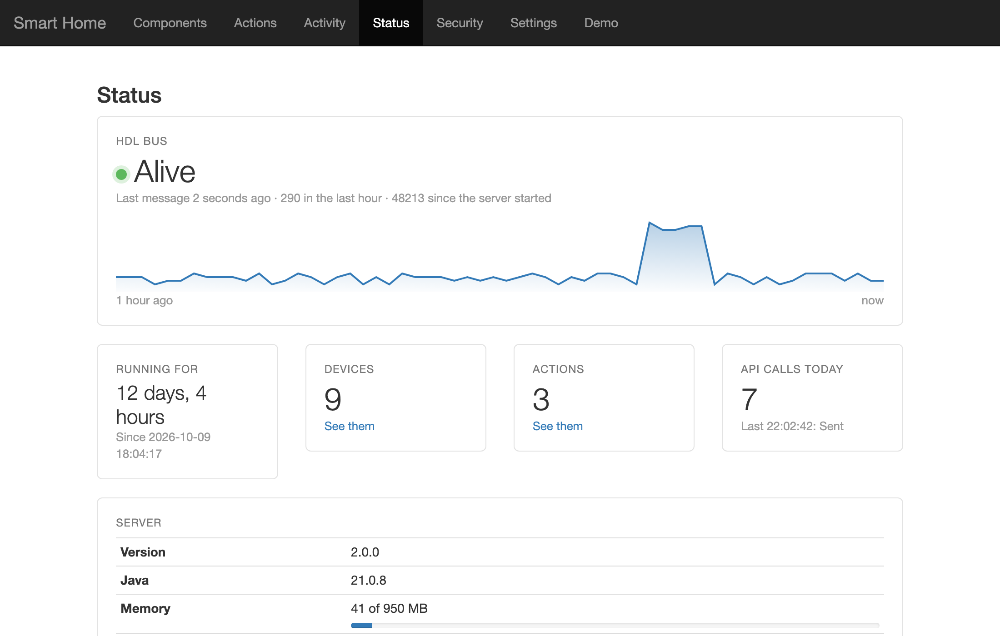
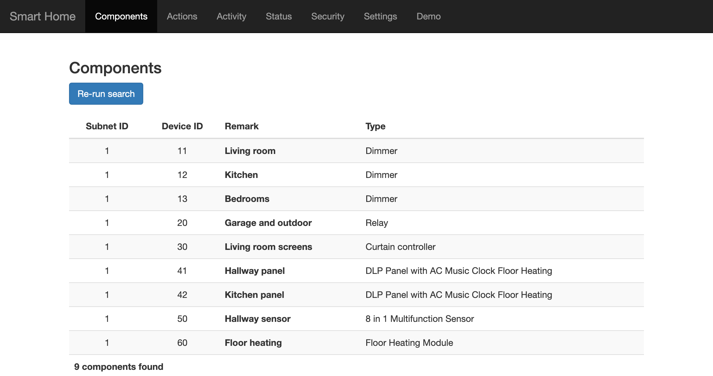
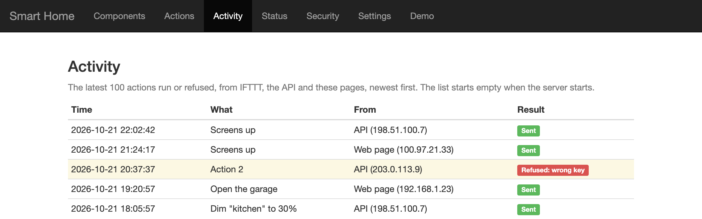
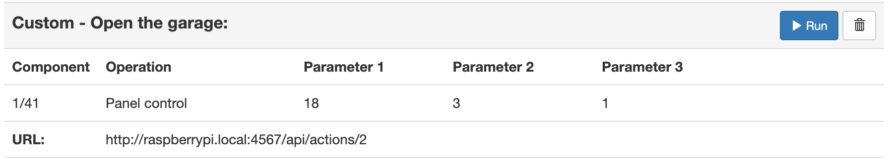

# 🏠 HDL Buspro server

**Talk to your HDL Buspro smart home.** *"OK Google, activate Screens up"*, and the screens go up.

A small, self-hosted bridge from web requests to HDL Buspro commands. Control your house from its web pages, from Google
Assistant through IFTTT, or from anything else that can send a web request. It runs happily on a Raspberry Pi.

[](https://github.com/roys/java-hdl-webserver/actions/workflows/build.yml)
[](https://github.com/roys/java-hdl-webserver/releases)

[](LICENSE)



[What you get](#-what-you-get) · [How it works](#-how-it-works) · [Quick start](#-quick-start) ·
[Raspberry Pi](#-set-it-up-on-a-raspberry-pi) · [Voice commands](#-voice-commands-with-ifttt) ·
[Updating](#-updating-the-server) · [Security](#-security)

---

## ✨ What you get

- 🔍 **Finds your devices.** Searches the bus and lists the modules that answer: dimmers, relays, curtains, panels, sensors.
- 🎛️ **Actions without code.** Set up dimmer and custom actions (panel buttons, curtains, switches) on a web page.
- ▶️ **Run them right there.** Test an action with one click, or set a dimmer to any level.
- 🎤 **Voice control.** Google Assistant through IFTTT, or Siri Shortcuts, Tasker, Home Assistant, `curl`…
- 📋 **Recent activity.** The latest 100 actions run or refused, with when and from where.
- 💓 **Status.** Is the HDL bus alive, how long has the server run, and how warm is the Pi (when it can tell).
- 🔒 **Protected.** A random key guards the API. The pages only answer your home network, or [Tailscale](https://tailscale.com/) when you're away.
- 🔄 **Safe updates.** One command checks that the new version runs on your Java before installing it, then restarts the server.

<table>
  <tr>
    <td></td>
    <td></td>
  </tr>
  <tr>
    <td align="center">The modules on the bus</td>
    <td align="center">Recent actions and refusals</td>
  </tr>
</table>

<sub>Screenshots show example data.</sub>

🎬 **See it in action:** [the original demo on YouTube](https://youtu.be/P6BgsM8IiW8)

---

## 🧭 How it works


You set up **actions** on the server's web page. Each action gets its own URL. When a request with the right key arrives
at that URL, the server sends the action's HDL commands to the bus.

---

## 🚀 Quick start

You need:

- An **HDL Buspro IP gateway** on the same network
- **Java 17 or later** (e.g. [Eclipse Temurin](https://adoptium.net/))
- [The server JAR](https://github.com/roys/java-hdl-webserver/releases/latest/download/hdlserver-LATEST.jar)

```sh
java -cp hdlserver-LATEST.jar com.roysolberg.java.hdlserver.Application
```

Then open **`http://<the computer's IP address>:4567`** from a computer on the same network. 🎉

Logs go to the `logs` folder, next to `hdlserver.db` (your key, actions and devices). On Windows, use `javaw` instead of
`java` to run it without a window.

For a server that starts by itself and keeps running, set it up as a service, like below.

---

## 🍓 Set it up on a Raspberry Pi

**1. Java and Git.** Raspberry Pi OS 11 (Bullseye) or later can run Java 17. Check with `java -version`, and if it's older
than 17:

```sh
sudo apt update
sudo apt install openjdk-17-jre-headless git
```

(On Raspberry Pi OS 13, `default-jre-headless` gives Java 21, which works too.)

**2. Get the server.**

```sh
cd ~
git clone https://github.com/roys/java-hdl-webserver.git
```

**3. Try it.** It should start and find your devices within a few seconds. Stop it with `Ctrl + C`.

```sh
cd ~/java-hdl-webserver/releases
java -cp hdlserver-LATEST.jar com.roysolberg.java.hdlserver.Application
```

**4. Run it as a service**, so it starts with the Pi and restarts if it ever stops. Paste this as it is (it fills in your
user name and home folder):

```sh
sudo tee /etc/systemd/system/hdlserver.service > /dev/null <<EOF
[Unit]
Description=HDL Buspro server
Wants=network-online.target
After=network-online.target

[Service]
User=$USER
WorkingDirectory=$HOME/java-hdl-webserver/releases
ExecStart=/usr/bin/java -cp hdlserver-LATEST.jar com.roysolberg.java.hdlserver.Application
Restart=on-failure
RestartSec=10
NoNewPrivileges=true
PrivateTmp=true
ProtectSystem=strict
ReadWritePaths=$HOME/java-hdl-webserver/releases

[Install]
WantedBy=multi-user.target
EOF
sudo systemctl daemon-reload && sudo systemctl enable --now hdlserver
```

Check it with `systemctl status hdlserver`.

> **Coming from an older guide?** It started the server with `@reboot ~/java-hdl-webserver/launcher.sh` in the crontab.
> Remove that line when you switch to the service, so the server isn't started twice.

**5. Open it to the Internet** (only needed for IFTTT and other outside callers):

- Give the Pi a fixed IP address in your router.
- Expose only `/api/`, preferably through an HTTPS reverse proxy. If you forward a port directly instead, forward a high
  port number other than 4567 to port 4567 on the Pi.
- Get a host name that follows your IP address, with dynamic DNS (many routers can do this themselves).

Only the API needs to be reachable from the Internet. For anything else, like SSH or the web pages, use a VPN like
[Tailscale](https://tailscale.com/) instead of forwarding more ports.

**6. Done!** ✅ Open `http://<the Pi's IP address>:4567` and set up your first action.

<details>
<summary>📜 Reading the logs</summary>

Inside `~/java-hdl-webserver/releases`:

```sh
tail -f logs/hdl-server.log   # what the server does
tail -f logs/hdl-bus.log      # everything on the HDL bus
```

A new log file is started every day, and files older than 30 days are deleted. The service's own output, including any
errors at startup, is in `journalctl -u hdlserver`.
</details>

---

## 🎤 Voice commands with IFTTT

Google Assistant doesn't talk to the server directly, so [IFTTT](https://ifttt.com/) sits in between. You'll need:

- **IFTTT Pro**, since IFTTT's [Webhooks](https://ifttt.com/maker_webhooks) need a paid plan.
- The server reachable from the Internet ([step 5](#-set-it-up-on-a-raspberry-pi) above).

### 1. Create an action

On the server's **Actions** page, create a **custom action**. Give it a name, e.g. *Open the garage*, and pick what it
should do. Pressing a panel button works great: choose the panel and **Panel control**, then set **Parameter 1** to `18` (Control
button), **Parameter 2** to the button number, and **Parameter 3** to `1` (on) or `0` (off). Add more commands to do
several things at once.

Click **▶ Run** to try it. 🎯



### 2. Create the IFTTT applet

1. Go to [ifttt.com/create](https://ifttt.com/create).
2. **If This:** choose [Google Assistant](https://ifttt.com/google_assistant_v2) and **Activate scene**. Name the scene, e.g. *Open the garage*.
3. **Then That:** choose **Webhooks** and **Make a web request**, and fill it in like this. The action's URL and your key are on the Actions page.

   | Field | Value |
   |---|---|
   | URL | `http://<your host name>:<your port>/api/actions/<action number>` |
   | Method | `POST` |
   | Content type | `application/json` |
   | Body | `{"auth":"<your key>"}` |

4. Save, wait a minute, and say: ***"OK Google, activate Open the garage."*** 🎉

You need one action and one applet for each command.

### Dimmer actions

Dimmer actions take a level from 0 to 100, so one action covers every level: *"…set the kitchen to 30 %"*. IFTTT's Google
Assistant can't pass on a number any more, so for voice, create a custom action for each level you want. You can still use
dimmer actions with any level from the Actions page, or from anything that can send a web request:

```sh
curl -X POST -H 'Content-Type: application/json' -d '{"auth":"<your key>","value":30}' \
  http://<your host name>:<your port>/api/actions/dimmer/kitchen
```

> 💡 Google is replacing Google Assistant with Gemini on its Home devices. If your phrases stop working, check that IFTTT's
> Google Assistant service still works with yours.

---

## 🔄 Updating the server

Run this inside `~/java-hdl-webserver`:

```sh
./update.sh
```

It checks that the new version runs on your Java *before* it changes anything, and then restarts the service. Your key,
actions and devices are kept (they're in `hdlserver.db`), so your IFTTT applets keep working.

Didn't use `git clone`? Replace `hdlserver-LATEST.jar` with
[the latest one](https://github.com/roys/java-hdl-webserver/releases/latest/download/hdlserver-LATEST.jar), and restart the server.

<details>
<summary>⚙️ Settings: another port, or a host name with dots in it</summary>

Settings go before `-cp` in the start command (or in `ExecStart` in the service, followed by `sudo systemctl daemon-reload`
and a restart):

| Setting | What it does |
|---|---|
| `-Dhdlserver.port=8080` | Listens on another port than 4567. Remember the port forwarding in your router, and your IFTTT applets' URLs. |
| `-Dhdlserver.allowedHosts=hdl.example.com` | Lets you open the pages by a host name with dots in it. IP addresses and local names like `raspberrypi` or `raspberrypi.local` always work. |

```sh
java -Dhdlserver.port=8080 -Dhdlserver.allowedHosts=hdl.example.com -cp hdlserver-LATEST.jar com.roysolberg.java.hdlserver.Application
```
</details>

### Upgrading to version 2

Version 2 needs **Java 17 or later** (version 1 ran on Java 8). Everything else stays the same: the start command, port
4567, the API your IFTTT applets call, and `hdlserver.db` with your key, actions and devices.

Version 1 lives on in the `master` branch, so `git pull` keeps you on version 1 until you choose to switch.

1. Check your Java with `java -version`. If it's older than 17, install a newer one first (see [the Raspberry Pi setup](#-set-it-up-on-a-raspberry-pi)).
2. Switch to version 2 inside `~/java-hdl-webserver`:
   ```sh
   git fetch origin
   git checkout v2
   ```
   (Or, without Git: replace the JAR with [the latest one](https://github.com/roys/java-hdl-webserver/releases/latest/download/hdlserver-LATEST.jar).)
3. Restart the server. From now on, `./update.sh` keeps you up to date.

Going back to version 1.1.1, which runs on Java 8, is just `git checkout master` and a restart (or download it from
[the 1.1.1 release](https://github.com/roys/java-hdl-webserver/releases/tag/v1.1.1)). If the server is started on a Java
older than 17, it says why, on the screen and in `logs/hdl-server.log`, and doesn't start.

Using the service from [step 4](#-set-it-up-on-a-raspberry-pi)? It's new in version 2: set it up, and remove the old
`@reboot` line from the crontab.

<details>
<summary>Small differences from version 1, if you call the server in other ways than described here</summary>

- The API no longer requires an `Accept: application/json` header (version 1 answered 404 to other values).
- The web pages' forms only read their fields from the request body, not from the URL.
- Requests with an `X-HTTP-Method-Override` header are refused (400), and so are ambiguous paths like `/api/%2e%2e/settings`.
</details>

---

## 🔒 Security

- 🔑 **The API is guarded by a key**, a random one made the first time the server starts. Requests without it are refused.
- 🏠 **The web pages only answer your local network**, or your [Tailscale](https://tailscale.com/) network, so you can use
  them away from home too.
- 🔐 **Use HTTPS** if you can, e.g. through a reverse proxy. Without it, someone between IFTTT and you could pick up a
  command and send it again.
- ⬆️ **Running version 1.0.3 or earlier?** [Update](#-updating-the-server). Those versions have known security vulnerabilities.

**Why is there no login on the web pages?** Anyone on your home network can already talk to HDL Buspro directly. It has no
security of its own, and everything is sent in plain text. A login would only give a false sense of security.

No software is perfect. There could be weaknesses in this server, the libraries it builds on, your router, IFTTT or Google
Assistant. Read more about security and HDL Buspro in
[My dumb smart home](https://blog.roysolberg.com/2017/08/my-dumb-smart-home).

---

## 🔨 Building from source

You need Java 17 or later:

```sh
./gradlew build
```

This runs the tests and builds the runnable JAR at `build/libs/hdlserver-<version>.jar`, which is what's released as
`releases/hdlserver-LATEST.jar`.

---

## 🔗 Links

- 📱 [My Android app for HDL Buspro](https://play.google.com/store/apps/details?id=com.roysolberg.android.smarthome)
- ✍️ [My dumb smart home](https://blog.roysolberg.com/2017/08/my-dumb-smart-home), a blog post on HDL Buspro and security
- 🎬 [The demo on YouTube](https://youtu.be/P6BgsM8IiW8)
- 🏢 [HDL Automation](https://www.hdlautomation.com/)
- 📝 [Changelog](releases/CHANGELOG.txt)
